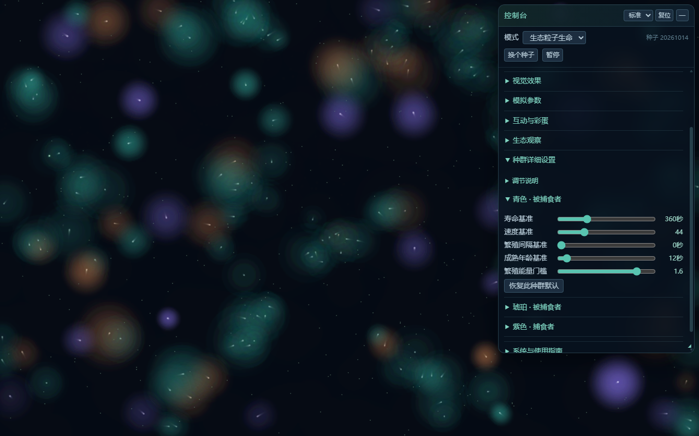
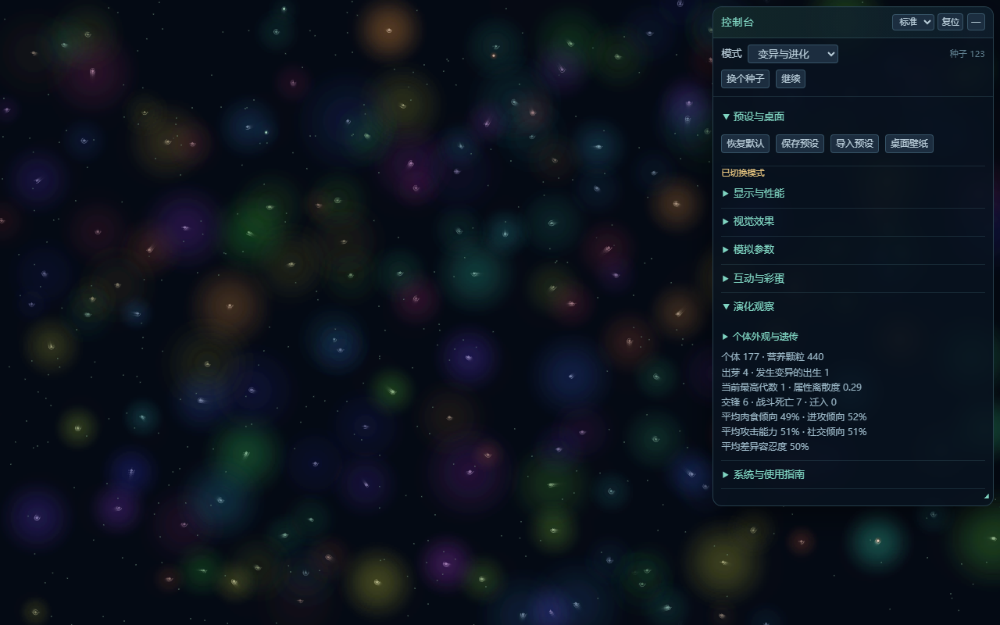

# 开发历程索引

项目从浏览器粒子原型出发，逐步成为Windows壁纸，再加入生态与遗传演化。本目录补充初始愿景、提交年表与关键截图；完整版本记录和验证报告位于上一级docs目录。

## 建议阅读顺序

1. [初始产品愿景](original-project-brief.md)：涌现行为与视觉美感并重的起点。
2. [视觉设计规范](../taste-profile.md)：呼吸、暗色背景、克制提示和面板的反馈演变。
3. [技术设计](../technical-design.md)：架构、取舍及后续变更。
4. [维护移交手册](../handover.md)：当前实现与历史维护经验。
5. [49次开发提交年表](commit-timeline.md)：开发工作的顺序。

## 阶段脉络

- 0.x：粒子生命/鱼群、光晕与拖尾治理、Windows壁纸、托盘、互动和彩蛋。
- 1.x：能量生态、出芽、群猎与独猎、头领护卫、种群参数、可拖动折叠面板。
- 2.0–2.1：独立遗传模式、相关变异、寿命速度与表型、非致死冲突和观察工具。
- 2.2：[种子环境与有效猎食](../release-v2.2.0.md)。
- 2.3：[弯曲地理、暗色线索和双亲繁殖](../release-v2.3.0.md)。

## 视觉阶段

### 1.5 控制台

### 2.0 初代遗传模式

### 2.3 种子地理

历史文档中“待验收”描述的是当时状态；一些方案已被后续版本替代，不应同时当作当前规则。这些档案不包含完整聊天逐字稿。原始Git历史与一次性脚本仅保存在私有本地备份，公开仓库采用去标识快照。
